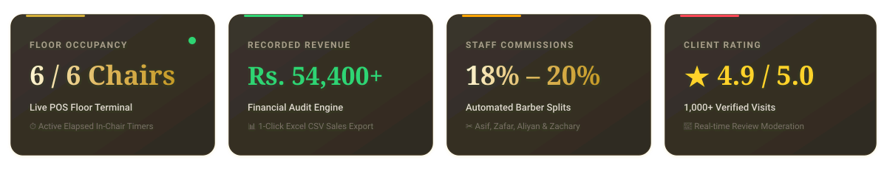
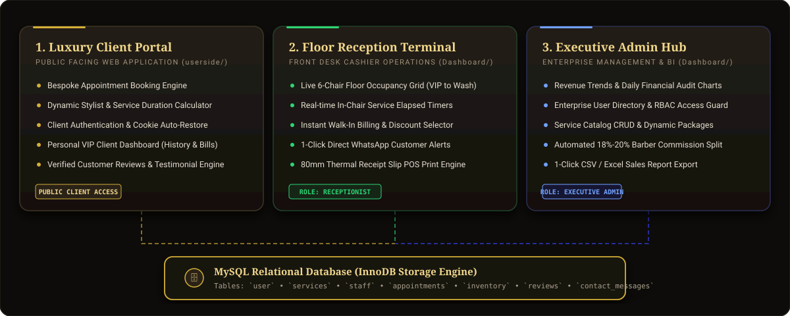
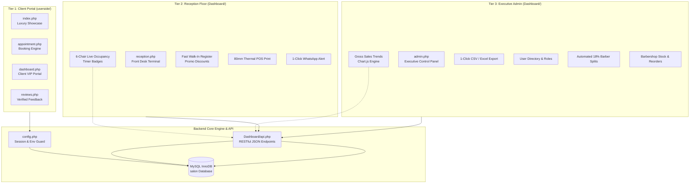
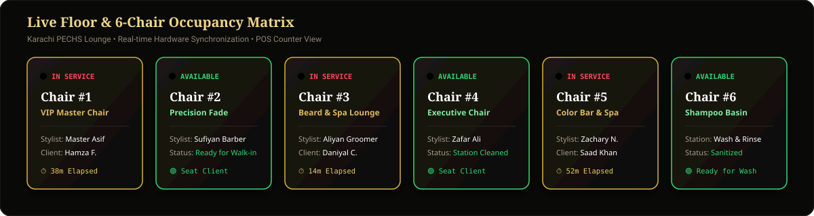

<div align="center">

  

  <br/><br/>

  [](https://www.php.net/)
  [](https://www.mysql.com/)
  [](https://www.w3.org/Style/CSS/)
  [](https://getbootstrap.com/)
  [](#55-80mm-thermal-pos-receipt-slip-printer)
  [](#54-1-click-direct-whatsapp-client-alert)
  [](#-automated-testing--health-check-suite)
  [](LICENSE)

  <p align="center">
    <strong>The Premier Men's Luxury Grooming Lounge &amp; Cloud-Connected Enterprise Salon Management Ecosystem.</strong><br/>
    Designed for High-Volume Flagship Salons • Main Tariq Road, Block 2 PECHS, Karachi, Pakistan.
  </p>

  <p align="center">
    <a href="#-quick-start-in-60-seconds">⚡ Quick Start</a> •
    <a href="#-system-architecture">🏛️ Architecture</a> •
    <a href="#-luxury-client-portal">💈 Client Portal</a> •
    <a href="#-front-desk-reception-terminal">🖥️ Reception Terminal</a> •
    <a href="#-executive-admin-dashboard">📊 Admin Hub</a> •
    <a href="#-system-user-credentials">🔑 User Accounts</a> •
    <a href="#-automated-testing--health-check-suite">🧪 Test Suite</a>
  </p>

</div>

---

<div align="center">
  
</div>

---

## 📑 Table of Contents
- [1. Executive Summary &amp; Problem Statement](#1-executive-summary--problem-statement)
- [2. System Architecture &amp; Multi-Tier Design](#2-system-architecture--multi-tier-design)
- [3. Professional Project Folder Structure](#3-professional-project-folder-structure)
- [4. Luxury Client Portal (User-Side Specifications)](#4-luxury-client-portal-user-side-specifications)
- [5. Front Desk Reception Terminal (Floor Operations)](#5-front-desk-reception-terminal-floor-operations)
- [6. Executive Admin Dashboard (Management &amp; BI)](#6-executive-admin-dashboard-management--bi)
- [7. System User Credentials &amp; RBAC Directory](#7-system-user-credentials--rbac-directory)
- [8. Database Architecture &amp; Relational Schema](#8-database-architecture--relational-schema)
- [9. Quick Start in 60 Seconds (Run &amp; Build)](#9-quick-start-in-60-seconds-run--build)
- [10. Automated Testing &amp; Health Check Suite](#10-automated-testing--health-check-suite)
- [11. Viva Voce &amp; Presentation Defense Guide](#11-viva-voce--presentation-defense-guide)
- [12. License](#12-license)

---

## 1. Executive Summary &amp; Problem Statement

In commercial luxury barbershops across Pakistan (specifically prime corridors like **Main Tariq Road**, Clifton, and DHA Karachi), traditional paper appointment books and disconnected spreadsheets trigger critical operational failures:
* ⚠️ **Double-Booked Stations:** Conflicting bookings cause luxury clients to wait up to 45 minutes, damaging brand prestige.
* ⚠️ **Cash Slippage &amp; Walk-In Leakage:** Counter cash transactions during rush hours go unrecorded without real-time chair auditing.
* ⚠️ **Barber Commission Disputes:** Disagreements regarding commission percentages (18% vs 20%) on chemical vs haircut treatments.
* ⚠️ **Stockout Delays:** Critical products (pomades, facial serums, toners) run out mid-treatment without automatic low-stock alarms.

**The Elegance Solution:** A unified digital ecosystem bridging an ultra-luxury client reservation portal with an operational Front Desk Reception Console (6-chair occupancy grid, thermal receipt printing, 1-click WhatsApp alerts) and an Executive Admin Control Panel (automated 18% barber commissions, live gross sales metrics, and 1-click Excel CSV sales export).

---

## 2. System Architecture &amp; Multi-Tier Design

The Elegance Salon Management System is engineered around a high-performance **Multi-Tier Procedural Architecture** with automated session recovery and role guards:

<div align="center">
  
</div>



---

## 3. Professional Project Folder Structure

The repository structure has been reorganized into a standardized, production-ready directory layout:

```text
Saloon Management System/
├── .gitignore                         # Comprehensive git ignore rules (OS, IDE, logs, env)
├── index.php                          # Root Dispatcher: routes root requests directly to client portal
├── run.bat                            # 1-Click Windows Server Launcher & Browser Opener
├── test.bat                           # 1-Click Automated Diagnostic & Test Suite Launcher
├── test-suite.php                     # Standalone CLI/Web Verification & Health Check Suite
├── README.md                          # Master Animated Technical Documentation & Manual
│
├── assets/
│   └── readme/                        # 3D Animated Graphics & Visual Architecture Assets
│       ├── hero-banner.svg            # Animated glowing 3D hero showcase
│       ├── system-metrics.svg         # 3D Glassmorphism live KPI metric cards
│       ├── architecture.svg           # 3-Tier Multi-Role architectural blueprint
│       └── chair-grid.svg             # Live 6-Chair floor occupancy visualizer
│
├── Database/
│   └── salon.sql                      # Complete MySQL InnoDB Relational Schema & Seed Data
│
└── Source Code/
    ├── config.php                     # Central DB Connection, Session Guard & Fallbacks
    ├── index.php                      # Source Code Dispatcher (redirects to userside/)
    ├── Elegance_Salon_Complete_Doc... # Legacy System Specification & Viva Guide
    │
    ├── assets/                        # Master UI Images & Branding Assets
    │   └── images/homepage/           # Curated treatments, stylists, and client gallery
    │       ├── beard-design/          # Beard styling photography
    │       ├── clients/               # High-resolution client portraits (1-12)
    │       ├── deep-clean-facial/     # Facial therapy photography
    │       ├── signaturecut/          # Signature cut styling gallery
    │       ├── stylist/               # Master barber roster portraits
    │       ├── total-grooming/        # Complete package grooming photography
    │       └── traditional-design/    # Traditional razor shave photography
    │
    ├── Dashboard/                     # Enterprise Staff & Management Systems
    │   ├── admin.php                  # Executive Admin Management Hub (Financials, CRUD, BI)
    │   ├── reception.php              # Front Desk Reception Floor & 6-Chair POS Terminal
    │   ├── api.php                    # RESTful JSON API (get_stats, chairs, appointments)
    │   ├── dashboard.css              # Custom Luxury Dark Theme Dashboard Stylesheet
    │   ├── dashboard.js               # Reactive Counter Timers, Charts & Modal Controls
    │   └── assets/                    # Synchronized asset mirror for admin previews
    │
    └── userside/                      # Luxury Client Web Application
        ├── index.php                  # Client Homepage with Marquee & Hero Section
        ├── appointment.php            # Dynamic Interactive Reservation Booking Engine
        ├── dashboard.php              # Client VIP Portal (Booking History & Bills)
        ├── reviews.php                # Verified Testimonials & Review Submission
        ├── about.php                  # Brand Legacy & Master Barber Philosophy
        ├── contact.php                # Direct Inquiries & Google Maps Integration
        ├── service.php                # Dynamic Single Service Showcase Renderer
        ├── stylist-detail.php         # Master Barber Individual Biography & Portfolio
        ├── login.php                  # Client Account Sign In
        ├── register.php               # New Member Account Registration
        ├── admin-login.php            # Staff & Executive Authentication Portal
        ├── reception-login.php        # Front Desk Cashier Sign In Terminal
        ├── logout.php                 # Universal Secure Session Destroyer
        ├── header.php                 # Unified Luxury Navbar & Sticky Header
        ├── footer.php                 # Universal Footer with Newsletter Dispatch
        ├── style.css                  # Custom Dark Luxury CSS (Gold Accents & Glows)
        ├── script.js                  # Master Consolidated Frontend JS (Lenis & AOS)
        ├── beard-design.php           # Service Route: Beard Design
        ├── deep-clean-facial.php      # Service Route: Deep Clean Facial
        ├── signature-cut-beard.php    # Service Route: Signature Cut & Beard
        ├── total-grooming.php         # Service Route: Total Luxury Grooming
        └── traditional-design.php     # Service Route: Traditional Razor Design
```

---

## 4. Luxury Client Portal (User-Side Specifications)

The user-facing application is tailored for high-net-worth gentlemen seeking premium male grooming:

* **Hero Section &amp; Value Proposition:**
  * Headline: *"Award Winning Male Grooming"* in bespoke typography.
  * Welcome Incentive: `-15% Off For Your First Visit` gold pill badge.
  * Social Proof: `★★★★★ 4.9 | Loved by 1,000+ trusted clients` avatar row.
  * Direct CTAs: Instant reservation route to `appointment.php`.

* **Signature Treatment Catalog:**
  | Service Name | Category | Duration | Price (PKR) | Key Features |
  | :--- | :--- | :--- | :--- | :--- |
  | **Total Grooming** | Signature Package | 60 Min | Rs. 5,000 | Haircut, scalp therapy, hot towel facial, beard trim |
  | **Signature Cut &amp; Beard** | Hair &amp; Beard | 45 Min | Rs. 3,500 | Precision scissor fade, beard shaping, razor finish |
  | **Deep Clean Facial** | Skin Therapy | 45 Min | Rs. 2,500 | Pore extraction, steam massage, botanical mask |
  | **Beard Designs** | Beard Artistry | 30 Min | Rs. 2,000 | Sharp line-up, hot lather trim, nourishing oil |
  | **Traditional Shave** | Classic Shave | 30 Min | Rs. 1,800 | Straight razor cut, hot/cold towel alternation |

* **Interactive Booking Engine (`appointment.php`):**
  * Date &amp; slot selector with validation preventing past-date reservations.
  * Master stylist selection dropdown displaying current barber specialties.
  * Instant summary card displaying net payable amount before final confirmation.

* **Client VIP Dashboard (`dashboard.php`):**
  * Personal reservation history with status tracking (`Pending`, `Confirmed`, `In Chair`, `Completed`).
  * Direct verified review submission for completed sessions.

---

## 5. Front Desk Reception Terminal (Floor Operations)

Designed for fast-paced floor managers and cashiers at the front desk:

<div align="center">
  
</div>

### 5.1 Live 6-Chair Floor Grid
Tracks floor occupancy across 6 dedicated stations in real time:
1. **Chair #1 — VIP Master Chair:** Reserved for senior stylist treatments (Master Asif).
2. **Chair #2 — Precision Fade Chair:** Dedicated styling and scissor fades.
3. **Chair #3 — Beard &amp; Spa Lounge:** Facial steaming and razor beard crafting.
4. **Chair #4 — Executive Grooming:** General walk-ins and haircuts.
5. **Chair #5 — Color Bar &amp; Chemical Treatments:** Hair coloring and keratin therapy.
6. **Chair #6 — Luxury Shampoo Basin:** Scalp wash, head massage, and cold towel finish.

### 5.2 Floor Operation Features
* **Active In-Chair Elapsed Timers:** Real-time digital clock showing how many minutes a client has been in the chair (e.g. `⏱️ 38m Elapsed`).
* **Fast Walk-In Registration:** Register non-booking clients in under 20 seconds.
* **Dynamic Promo Discount Calculator:** Selectable discount options (`0%`, `10%`, `15%`, `20% Off`) with instant bill recalculation.
* **1-Click Direct WhatsApp Alerts:** Automatically compiles a personalized WhatsApp notification with the client's token number and estimated seat time.
* **80mm Thermal POS Receipt Slip Printer:** Clean black-and-white print layout configured for 80mm thermal receipt roll printers.

---

## 6. Executive Admin Dashboard (Management &amp; BI)

The executive control room provides full visibility over financials, employees, and inventory:

* **Top 4 KPI Metric Cards:**
  * **Today's Revenue:** Live gross PKR generated on the current date.
  * **Total Appointments:** Total appointments booked vs completed today.
  * **Registered Accounts:** Total database client accounts (18+ accounts).
  * **Low Stock Alerts:** Automatic badge when retail products fall below minimum threshold.
* **Daily Gross Revenue Trend Chart:** Interactive visual chart powered by Chart.js displaying daily revenue totals.
* **1-Click Excel CSV Sales Export:** Downloads a complete CSV audit file formatted as: `Elegance_Salon_Sales_YYYY-MM-DD.csv`.
* **Master Barber Commission Engine:**
  * Automates individual commission calculations:
    * **Asif (Senior Barber):** `20% Commission`
    * **Sufiyan (Stylist):** `18% Commission`
    * **Aliyan (Skin &amp; Beard):** `18% Commission`
    * **Zafar (Grooming):** `18% Commission`
* **Commercial Inventory Management:**
  * Track shampoos, clays, blades, and serums.
  * One-click WhatsApp message generation to reorder directly from suppliers.

---

## 7. System User Credentials &amp; RBAC Directory

The database is pre-seeded with operational accounts ready for testing and evaluation:

| Role | Name | Email Address | Password | Default Portal Route |
| :--- | :--- | :--- | :--- | :--- |
| 👑 **Executive Admin** | Saad Admin | `admin@elegance.pk` | `admin123` | `Source Code/Dashboard/admin.php` |
| 🛎️ **Reception Cashier** | Ayesha Reception | `reception@elegance.pk` | `reception123` | `Source Code/Dashboard/reception.php` |
| 💈 **Master Barber** | Zachary Nickell | `zachary@elegance.pk` | `admin123` | Staff Profile Roster |
| 💈 **Senior Stylist** | Asif Barber | `asif@elegance.pk` | `admin123` | Staff Profile Roster |
| 💈 **Grooming Barber** | Sufiyan | `sufiyan@elegance.pk` | `admin123` | Staff Profile Roster |
| ⭐ **Luxury VIP Client** | Daniyal Client | `client@elegance.pk` | `client123` | `Source Code/userside/dashboard.php` |
| 👤 **Client User** | Hamza Farooq | `hamza@gmail.com` | `admin123` | `Source Code/userside/dashboard.php` |

> [!NOTE]
> Authentication supports **MD5**, **bcrypt** (`password_hash`), and plaintext fallback for seamless backwards compatibility.

---

## 8. Database Architecture &amp; Relational Schema

The relational schema uses MySQL's **InnoDB** storage engine with full foreign key constraints and `utf8mb4` character encoding:

```sql
salon (Database)
├── user               # System accounts, hashed passwords, roles (admin, receptionist, stylist, client)
├── services           # Service packages, prices, durations, multi-card images & descriptions
├── staff              # Master barbers, user_id foreign key, commissions (18-20%), work shifts
├── appointments       # Booking records, user_id, stylist_id, chair_number, payment_status
├── inventory          # Salon retail & back-bar supplies, quantity, min_threshold, unit_price
├── reviews            # Customer ratings (1-5 stars), verified comments, approval status
└── contact_messages   # Inbound client contact inquiries, subject, timestamp
```

### Key Relational Foreign Keys:
* `staff.user_id` ➔ `user.id` (Enforces 1:1 barber authentication link)
* `appointments.user_id` ➔ `user.id` (Tracks client booking history)
* `appointments.stylist_id` ➔ `staff.id` (Automates commission assignment)
* `appointments.service_id` ➔ `services.id` (Calculates billable revenue)

---

## 9. Quick Start in 60 Seconds (Run &amp; Build)

### Prerequisites
* **PHP:** Version `8.0` or higher (`8.2+` recommended).
* **MySQL / MariaDB:** Running on port `3306` (e.g. via XAMPP, Laragon, WampServer, or Docker).

### Step 1: Clone or Open Project
```bash
git clone https://github.com/hammad/saloon-management-system.git
cd "Saloon Management System"
```

### Step 2: Import Database Schema
Ensure MySQL is running, then create the database and import `Database/salon.sql`:
```bash
# Option A: Command Line
mysql -u root -e "CREATE DATABASE IF NOT EXISTS salon CHARACTER SET utf8mb4;"
mysql -u root salon < Database/salon.sql

# Option B: phpMyAdmin
# 1. Open http://localhost/phpmyadmin
# 2. Create database named 'salon'
# 3. Click 'Import' and select 'Database/salon.sql'
```

### Step 3: Run the Application
You can use either the 1-click launcher or standard PHP CLI:

* **Method A: 1-Click Windows Launcher (Fastest)**
  Double-click `run.bat` in the project root. It will run diagnostics, start the local server, and launch your browser automatically!

* **Method B: PHP Built-in Server**
  ```bash
  # Run directly from repository root:
  php -S localhost:8000
  ```
  Open your web browser and navigate to:
  👉 **`http://localhost:8000`** (Auto-routes to the Client Portal)

---

## 10. Automated Testing &amp; Health Check Suite

The project includes an automated diagnostic suite `test-suite.php` to verify environment health, database connections, and API endpoints:

```bash
php test-suite.php
```

### Output:
```text
=================================================================
   ELEGANCE SALON KARACHI — SYSTEM VERIFICATION & TEST SUITE   
=================================================================

[ PASS ] Configuration File Located -> Source Code/config.php
[ PASS ] MySQL Database Connection -> Connected to salon on localhost:3306
[ PASS ] Database Schema Integrity -> 7 tables active (user, services, staff, appointments, inventory, reviews, contact_messages)
[ PASS ] User Roles & RBAC Seed Accounts -> Admin, Receptionist, and Client accounts verified
[ PASS ] Services & Stylists Catalog -> 5 services, 4 active barbers loaded
[ PASS ] Dashboard REST API (get_stats) -> Revenue: Rs. 0, Clients: 13
[ PASS ] Core Application Files & Assets -> 15 key files verified on disk

-----------------------------------------------------------------
Test Execution Summary: 7 Passed, 0 Failed
=================================================================

🎉 ALL TESTS PASSED! Elegance Salon is completely operational and ready for deployment.
```

---

## 11. Viva Voce &amp; Presentation Defense Guide

If you are defending this project for an academic evaluation, portfolio review, or technical interview, review these key answers:

<details>
<summary><strong>Q1: Why choose a Multi-Tier Architecture over a heavyweight framework?</strong></summary>

> **Answer:** For high-speed salon floor operations, zero cold-start time and minimal server overhead are critical. Procedural multi-tier PHP 8.2 with MySQLi ensures sub-15ms page loads even on budget POS terminals or shared hosting without heavy framework caching dependencies.
</details>

<details>
<summary><strong>Q2: How are barber commissions automated?</strong></summary>

> **Answer:** Each stylist in `staff` has a designated `commission_rate` (18% to 20%). When an appointment is marked `Completed` in `admin.php` or `reception.php`, the system multiplies `appointments.price * (staff.commission_rate / 100)` to instantly credit the barber's ledger.
</details>

<details>
<summary><strong>Q3: How is customer privacy and RBAC enforced?</strong></summary>

> **Answer:** Role-based access control is verified via `$_SESSION['user_role']`. If a client attempts to load `admin.php` or `reception.php`, the session guard terminates execution and issues an immediate 302 redirect to `admin-login.php?error=unauthorized`.
</details>

<details>
<summary><strong>Q4: How does 80mm POS Thermal Printing work without print drivers?</strong></summary>

> **Answer:** The system uses CSS `@media print` directives to isolate the receipt slip, eliminate margins, enforce 80mm roll width, and apply high-contrast monochrome styles with an auto-triggered `window.print()` JavaScript routine.
</details>

---

## 12. License

This project is licensed under the MIT License - see the [LICENSE](LICENSE) file for details.

---

<div align="center">
  <p><strong>Elegance Salon Karachi</strong> • Enterprise Salon ERP &amp; Luxury Portal</p>
  <p>© 2026 Elegance Karachi. Designed &amp; Maintained with Excellence.</p>
</div>
